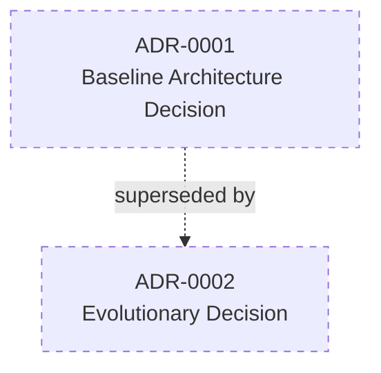

# Architectural Decision Records (ADRs)

Architectural decisions govern non-trivial engineering commitments, trade-offs, and invariants. They are authored under `adr/` and synchronized into this vault.

## 🕸️ ADR Supersession Graph

## 📋 ADR Catalog

| ADR | Title | Status | Date | Core Commitment |
| :--- | :--- | :--- | :--- | :--- |
| *(No ADRs recorded yet)* | Initial architectural decisions will be cataloged here | Pending | - | Author with `architectural-decision-records` skill |

---
[[Home|← Back to Home]] | [[Overview/Overview|Architecture Overview →]]
