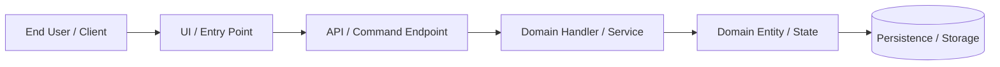

# [Capability Name]

> **Operational Purpose**: [Plain-language summary of what this capability provides to end-users and how it fits into the broader platform].

---

## 1. Domain Model & Architecture

[Explain the key aggregates, entities, services, and UI components executing this capability].

---

## 2. Core Workflows & Business Invariants

> **Readability Principle**: Explain workflows in natural, present-tense business prose. Do NOT paste raw Gherkin `GIVEN/WHEN/THEN` syntax here.

### [Workflow 1 Title]
- When the user triggers this action, the system validates that...
- If validation succeeds, the state transitions to...
- Side-effects (notifications, integration messages) are emitted via...

### [Workflow 2 Title]
- Under condition X, the system ensures that invariant Y is never violated...

---

## 3. Key Decisions & Gotchas

- **[Decision 1]**: [Why the team chose this architectural approach over alternatives].
- **[Gotcha / Constraint]**: [Critical technical or business rule developers must keep in mind when modifying this code].

---
[[Home|← Back to Home]] | [[Features/Overview|← Features Index]]
