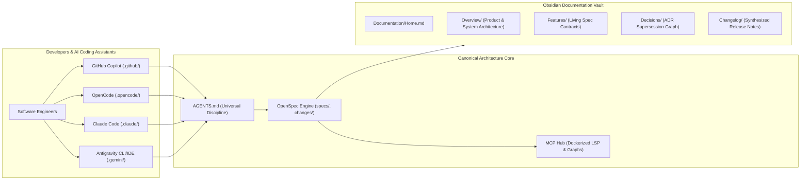

# System Knowledge Base: ai-scaffolding

> **ai-scaffolding** — Enterprise-grade multi-harness AI engineering scaffold and starter monorepo.

Welcome to the developer knowledge vault for **ai-scaffolding** (Software Application). This vault is organized into structured sections for onboarding, rapid architectural refresh, technical contracts, and AI-assisted engineering.

---

## 🗺️ Master Navigation (Map of Content)

### 1. 🏗️ Overview — System Context & Architecture

High-level product mission, C1/C2 system context, container topology, and technology stack.

- **[[Overview/Overview|Architecture Overview & Reading Guide]]**: Master architectural landing page and tailored reading trajectories.

#### Executive Architecture Scorecard
- **Hosting & Environment**: Multi-Harness Monorepo (Windows, Linux, macOS, Container MCP Hub)
- **Core Execution Tier**: **Software Application** built with **Polyglot**
- **Persistence Tier**: File-based, In-Memory, or Configuration-Driven
- **Interfaces & Routing**: CLI subcommands, library APIs, and modular routines
- **Primary Frameworks**: Polyglot

| Document | Architectural Level | Description |
| :--- | :--- | :--- |
| **[[Overview/Overview]]** | **Landing Page** | Master architectural mental model, reading paths for engineers, and subsystem index. |
| **[[Overview/Product-Overview]]** | **C1 Context** | Operational mission, actors, workspaces, and end-to-end lifecycle. |
| **[[Overview/System-Architecture]]** | **C2 Containers** | Container topology, multi-host deployment layout, and communication matrix. |

---

### 2. ⚡ Features — Product Capabilities & Workflows

End-to-end product capabilities and user workflows mapped directly to `openspec/domains.yaml`.

- See **[[Features/Overview]]** for the complete domain capability catalog.
- Living capability format reference: **[[Features/Feature-Template|Feature Specification Template]]**.

---

### 3. 🏛️ Decisions — Architectural Decision Records (ADRs)

Architectural commitments, trade-offs, and supersession history.

- See **[[Decisions/Overview]]** for the master index and interactive Mermaid supersession graph.

---

### 4. 📜 Changelog — Release & Change History

Human-readable product change history synthesized from OpenSpec change records.

- See **[[Changelog/Overview]]** for the chronological release and change history.

---

### 5. 📖 Guides & Technical Reference

- **[[Guides/Developer-Onboarding|Developer Onboarding & Workflow Guide]]**: Multi-harness developer environment, OpenSpec lifecycle, and discipline.
- **[[Guides/OpenSpec-Governance|OpenSpec Domain & Capability Governance]]**: Canonical governance rules from `openspec/GOVERNANCE.md`.
- **[[Guides/OpenSpec-Schemas|OpenSpec Schemas & Syntax]]**: Formal artifact schemas from `openspec/SCHEMAS.md`.
- **[[Reference/Domain-Catalog|Architectural Domain Catalog]]**: System bounded contexts and capabilities registered in `openspec/domains.yaml`.
- **[[Reference/Configuration-Guide|Configuration Guide]]**: Centralized runtime settings, environment precedence, and secrets governance.
- **[[Reference/Overview|Technical Reference Index]]**: Contracts and platform catalogs.

---

## 🏛️ System Domains & Capabilities

### Core Platform
*Foundational infrastructure, storage abstractions, configuration, and security services*

- *No specifications documented yet for this domain.*

### API & Backend Services
*RESTful endpoints, external API gateways, and asynchronous event messaging pipelines*

- *No specifications documented yet for this domain.*

### Web Client Applications
*Frontend single-page applications, UI component libraries, and client-side state*

- *No specifications documented yet for this domain.*

---
*Dynamically maintained by OpenSpec Documentation Sync. Run `/opsx-sync-docs` (or `/opsx:sync-docs`) to refresh.*
