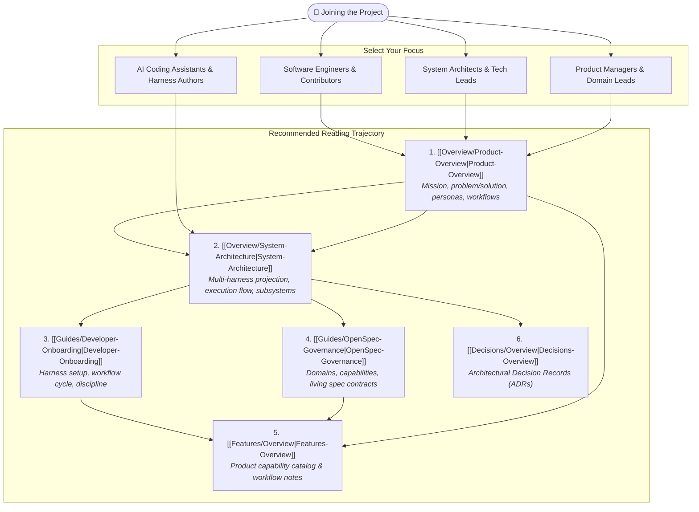

# System Overview & Architecture Guide: ai-scaffolding

> **Target Audience**: Software Engineers, System Architects, DevOps Leads, and Product Managers seeking an authoritative, unified mental model of **ai-scaffolding** (Software Application).

Welcome to the architectural nerve center of the knowledge vault. This section breaks down the system from high-level operational context (C1) down to container topologies (C2) and internal execution models (C3).

---

## 🗺️ Architectural Reading Paths

Choose the reading order tailored to your role:

---

## 📚 Overview Document Catalog

| Document | Architectural Level | Core Questions Answered | Primary Models & Diagrams |
| :--- | :--- | :--- | :--- |
| **[[Overview/Product-Overview|Product-Overview]]** | **C1 — System Context** | Why does the system exist? What operational problem does it solve? Who are the actors and what is the end-to-end lifecycle? | C1 System Context diagram, Operational Persona Workspaces, Lifecycle Timeline. |
| **[[Overview/System-Architecture|System-Architecture]]** | **C2 — Container Topology** | What physical containers run in production? How do hosts, services, and storage interact? What are the network ports and protocols? | Full C2 Container Topology diagram, Subsystem Component Index, System Communication Matrix. |

---

## 🏛️ Foundational Architectural Invariants

1. **Living Spec-Driven Development**: All non-trivial modifications, bug fixes, and feature additions originate as OpenSpec change proposals with verifiable behavior contracts before code is written.
2. **Deterministic Time Management**: Never invoke system clock methods directly in domain logic. Always inject a clock or time provider abstraction to guarantee determinism in automated test suites.
3. **Anti-Fabrication Mandate**: Never fabricate metrics, benchmark percentages, performance claims, or test counts without empirical measurement in source code or execution logs.
4. **Git Commit Approval Gate**: Code modifications and commits require explicit developer confirmation. Agents never commit without developer consent.
5. **Clean Architectural Boundaries**: Dependencies flow strictly inward from presentation and entry points to core domain logic and contracts.

---
[[Home|← Back to Home]] | [[Overview/Product-Overview|Product Overview →]]
