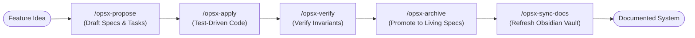

# Product Overview: AI Scaffolding

## 🎯 Executive Summary
**AI Scaffolding** is an enterprise-grade, multi-harness AI engineering scaffold and starter monorepo. It establishes a unified, specification-driven pair-programming workflow across all major AI coding assistants—**GitHub Copilot**, **OpenCode**, **Claude Code**, and **Google Antigravity CLI & IDE**—while maintaining a living, bidirectional product documentation vault in Obsidian.

---

## 💡 The "WHAT": Purpose & Value Proposition

### The Problem
When engineering teams leverage diverse AI coding assistants across terminals and IDEs, critical challenges emerge:
1. **Instruction Fragmentation**: Different AI tools require different configuration files (`.github/`, `.opencode/`, `.claude/`, `.gemini/`), causing agent behaviors to diverge.
2. **Hallucination & Spec Drift**: Without strict living specifications, AI agents invent APIs, fabricate metrics, or produce contradictory implementations.
3. **Documentation Decay**: Traditional documentation rapidly goes stale as code evolves, disconnecting product requirements from working reality.

### Value Delivered
- **Unified Instruction Governance**: All agents align to canonical engineering principles defined in `AGENTS.md` and mirrored across all harness directories.
- **Spec-First Living Contracts**: Features begin as OpenSpec proposals and delta specifications before code is written, ensuring verifiable invariants.
- **Automated Documentation Sync**: Code modifications, living specs, ADRs, and change histories automatically compile into an Obsidian-compatible product knowledge graph.
- **Dockerized Codebase Intelligence**: A centralized MCP Hub provides compiler-grade LSP symbols, knowledge graph relationships, and semantic search without IDE vendor lock-in.

### Target Personas & System Consumers
- **Software Engineers**: Building applications with consistent, guided pair-programming workflows.
- **AI Coding Agents**: GitHub Copilot, Claude Code, OpenCode, and Antigravity operating within strict, safe governance boundaries.
- **Architects & Tech Leads**: Reviewing system evolution through durable Architecture Decision Records (ADRs) and living domain specs.

---

## 🌟 Core Capabilities & Feature Tour

- **Multi-Harness Scaffolding**: Pre-configured rules, commands, and skills for GitHub Copilot (`.github/`), OpenCode (`.opencode/`), Claude Code (`.claude/`), and Antigravity (`.antigravity/`, `.gemini/`).
- **OpenSpec Workflow Engine**: Standardized lifecycle commands (`/opsx-propose`, `/opsx-apply`, `/opsx-verify`, `/opsx-archive`, `/opsx-sync-docs`) enforcing rigorous intent-driven design.
- **Living Documentation Vault (`Documentation/`)**: An Obsidian-ready knowledge base organized by product concerns (Overview, Features, Guides, Reference, Decisions, Changelog) rather than raw repository folders.
- **AST Symbol & Codebase Grasp via Repomix**: Leverages AST compression and symbol fingerprinting to track changes and pack instant context for agents.
- **Isolated Agent Scratchpads (`.agent-workspace/`)**: Keeps application codebases completely clean by confining temporary logs, task tokens, and symbol digests to isolated workspaces.

---

## 🔄 Core Workflows & User Journeys

### 1. The OpenSpec Feature Lifecycle


### 2. Daily Developer Flow
1. **Explore & Design**: Run `/opsx-propose` to scaffold a new change under the appropriate domain in `openspec/domains.yaml`.
2. **Implement**: Work task-by-task with your preferred AI harness; the AI follows test-driven development and never commits without approval.
3. **Archive & Synchronize**: Finalize the change via `/opsx-archive` and run `/opsx-sync-docs` to update the documentation vault.

---

## 📊 System Profile & Technology Stack

| Dimension | Details |
| :--- | :--- |
| **Project Name** | `AI Scaffolding` |
| **Architecture Model** | Multi-Harness AI Engineering Monorepo |
| **Supported AI Harnesses** | GitHub Copilot, OpenCode, Claude Code, Antigravity |
| **Specification Engine** | OpenSpec (Intent-Driven Schema) |
| **Documentation Format** | Obsidian-Compatible Markdown with Frontmatter & Wikilinks |
| **AST Symbol Engine** | Tree-sitter Compression (Repomix) + Native Language AST Parser |

---

## 📦 Codebase Composition & Organization

```
ai-scaffolding/
├── apps/               ← Applications (web, mobile, service hosts)
├── libs/               ← Shared libraries (domain, data-access, ui, util)
├── openspec/           ← Living specifications, domain catalog, and change proposals
├── Documentation/      ← Synchronized Obsidian product documentation vault
├── adr/                ← Architecture Decision Records
├── glossary/           ← Ubiquitous business and technical language
├── .agents/            ← Universal skills and automation scripts
├── .mcp-hub/           ← Dockerized codebase intelligence MCP server
├── .agent-workspace/   ← Isolated agent scratch state and AST symbol snapshots
└── [harness configs]   ← .github/, .opencode/, .claude/, .gemini/
```

---
[[Home|← Back to Home]] | [[Overview/System-Architecture|System Architecture →]]
