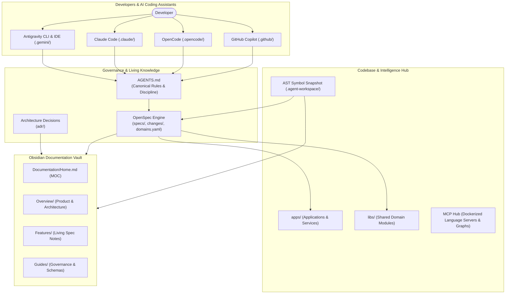
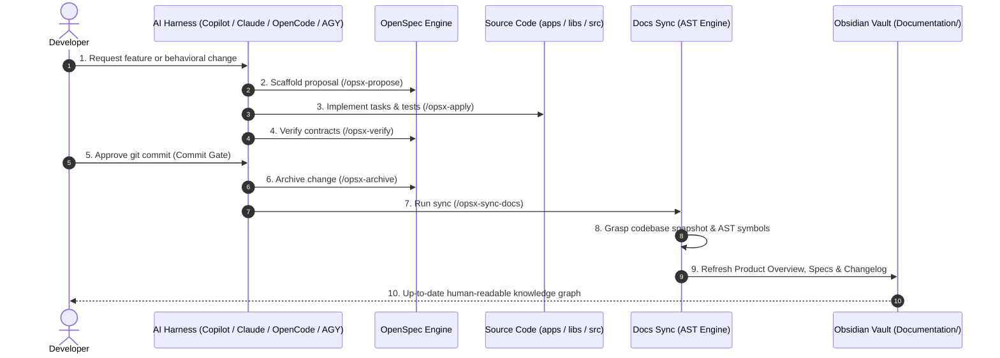

# System Architecture: ai-scaffolding

## 🏛️ The "HOW": Architectural Philosophy & Design
The codebase operates under a **Multi-Harness AI Engineering Monorepo** architectural model. It decouples system specifications from implementation code, using a hub-and-spoke configuration model:
- **Canonical Instruction Anchor**: `AGENTS.md` defines universal discipline, testing invariants, and anti-fabrication rules.
- **Harness Projection**: Domain rules, skills, and prompts project outwards into AI harness directories (`.github/`, `.opencode/`, `.claude/`, `.gemini/`).
- **Living Specification Engine**: System requirements reside as living behavior contracts in `openspec/specs/`, modified only through formal change proposals.
- **Dynamic Documentation Vault**: Product documentation compiles automatically from codebase state, living specs, and ADRs into `Documentation/`.

---

## 🗺️ Component Architecture & System Context

---

## 🔁 End-to-End Execution Flow (Data & Control Lifecycle)

---

## 🧩 Subsystem & Directory Responsibilities

### 1. Applications & Host Services (`apps/`)
- **Role**: Deployment-level binaries, services, and web clients.
- **Responsibilities**: Entry-point bootstrapping, framework wiring, HTTP routing, and environment runtime initialization.
- **Boundaries**: Business logic belongs in `libs/`; `apps/` only orchestrates presentation and hosting.

### 2. Shared Libraries & Domain Modules (`libs/`)
- **Role**: Reusable, pure domain logic, data-access repositories, and UI components.
- **Responsibilities**: Enforcing domain invariants, entity validation, and data persistence contracts.
- **Boundaries**: Independent of application shells; testable in complete isolation.

### 3. Living Specifications (`openspec/specs/`)
- **Role**: The single source of truth for all system behavioral contracts.
- **Responsibilities**: Documents requirements and Gherkin scenarios grouped by architectural domain and capability.

### 4. Product Documentation Vault (`Documentation/`)
- **Role**: Local, Obsidian-compatible markdown documentation for humans and agents.
- **Structure**:
  - `Documentation/Home.md`: Master Map of Content (MOC).
  - `Documentation/Overview/`: High-level product vision and system architecture.
  - `Documentation/Features/`: Behavioral contracts compiled from living specs.
  - `Documentation/Guides/`: Developer onboarding, OpenSpec Governance, and Schema reference.
  - `Documentation/Reference/`: Configuration reference and Domain Catalog.
  - `Documentation/Decisions/`: Synced Architecture Decision Records (ADRs).
  - `Documentation/Changelog/`: Historical changes compiled from archived proposals.

---

## ⚖️ The "WHY": Design Rationale & Trade-offs

### Architectural Invariants
1. **Spec-First Intent**: Code is an ephemeral manifestation of living specifications. Changing system behavior requires updating living specs.
2. **Anti-Fabrication Mandate**: Agents never invent benchmark numbers, performance statistics, or test counts. Empirical evidence is mandatory.
3. **Strict Commit Approval Gate**: Agents never execute git commits or pushes without explicit confirmation from the human developer.
4. **Clock Injection**: Time-dependent domain services always inject clock abstractions (`Clock`, `TimeProvider`) to guarantee test determinism.

### Architectural Trade-offs
| Decision | Chosen Approach | Alternative Considered | Rationale / Why |
| :--- | :--- | :--- | :--- |
| **Documentation Format** | Obsidian-compatible local Markdown | Cloud SaaS (Confluence, Notion) | Zero external dependencies, offline-first, git-tracked, versioned alongside code. |
| **Codebase Grasping** | Tree-sitter AST compression + Native AST fallback | Full-repo re-indexing on each turn | Extracts AST symbol signatures in <2s and hashing avoids redundant re-processing. |
| **Specification Syntax** | OpenSpec Gherkin callouts in Markdown | Cucumber feature files only | Human-readable markdown with clear scenario blocks is natively parsed by LLMs and Obsidian. |
| **Harness Architecture** | Centralized canonical rules (`AGENTS.md`) | Separate rules per harness | Single source of truth eliminates rule drift across Copilot, Claude, OpenCode, and Antigravity. |

---

## 📐 Alignment with OpenSpec Domains
System architecture aligns with the architectural domains declared in `openspec/domains.yaml`:

- **[[Reference/Domain-Catalog#Core Platform|Core Platform]]**: Foundational infrastructure, storage abstractions, configuration, and security services
- **[[Reference/Domain-Catalog#Api Services|API & Backend Services]]**: RESTful endpoints, external API gateways, and asynchronous event messaging pipelines
- **[[Reference/Domain-Catalog#Web Client|Web Client Applications]]**: Frontend single-page applications, UI component libraries, and client-side state

---
[[Home|← Back to Home]] | [[Overview/Product-Overview|← Product Overview]]
