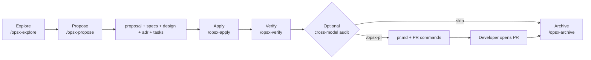

# AI Scaffolding

A standardized, multi-harness AI engineering template for modern monorepos.

Copy it into a new repository and every AI coding harness you use — **OpenCode**, **VS Code / GitHub Copilot**, **Antigravity CLI (`agy`) & IDE**, and **Claude Code** — starts from the same instructions, the same spec-first workflow, and the same quality gates. The template contains no product code and no domain assumptions; it is the operating system, not the application.

---

## Table of Contents

- [Why This Template Exists](#why-this-template-exists)
- [The Workflow](#the-workflow)
- [Repository Layout](#repository-layout)
- [Supported AI Harnesses](#supported-ai-harnesses)
- [OpenSpec System](#openspec-system)
- [Codebase Intelligence (MCP Hub)](#codebase-intelligence-mcp-hub)
- [Skills Management](#skills-management)
- [Quickstart: Bootstrapping a New Monorepo](#quickstart-bootstrapping-a-new-monorepo)
- [Customization Checklist](#customization-checklist)
- [Rules Every Agent Inherits](#rules-every-agent-inherits)

---

## Why This Template Exists

AI coding agents are fast, but left unconstrained they drift: they invent requirements, skip verification, disagree with each other across editors, and claim success without evidence. This template fixes that with four ideas:

1. **One rule set, every harness.** `AGENTS.md` is the canonical instruction anchor. `CLAUDE.md`, `GEMINI.md`, and `.github/instructions/` point back to it, so a decision made in one editor does not silently diverge in another.
2. **Intent before code.** Non-trivial work flows through OpenSpec: a proposal, behavior specs, a design, an ADR review, and a task list. Implementation is the last step, not the first.
3. **Evidence over assertion.** Anti-fabrication rules forbid invented metrics and require verification output before anything is called done.
4. **Independent review.** The model that wrote the code is the worst judge of it. An optional cross-model audit checks the change against its specs and against security/quality standards, then prepares the Pull Request without ever pushing it.

The template itself is not a project. It intentionally ships **no OpenSpec changes and no ADRs of its own** — `openspec/changes/` and `adr/` are created by the first change in the project that adopts it.

---

## The Workflow

This is the lifecycle the template is built around. Optional steps are marked; everything else is the default path.



### 1. Explore (optional)

Think through requirements, constraints, and domain language before committing to an artifact set. Explore mode never writes implementation code; it ends by pointing at `/opsx-propose`.

### 2. Propose

`/opsx-propose <change>` creates the change and walks the OpenSpec DAG:

| Artifact | File | Purpose |
| :--- | :--- | :--- |
| Proposal | `proposal.md` | Why this change, what changes, which `<domain>/<capability>` it touches |
| Specs | `specs/<domain>/<capability>/spec.md` | Gherkin-style `GIVEN` / `WHEN` / `THEN` behavior deltas |
| Design | `design.md` | Architecture, C4 boundaries, decisions, trade-offs |
| ADR review | `adr.md` | Which durable decisions were recorded, and where |
| Tasks | `tasks.md` | Checkbox implementation plan, ordered by dependency |

### 3. Apply

`/opsx-apply <change>` works through `tasks.md` one item at a time, using TDD and verification-before-completion, and marks checkboxes only when the specified behavior is actually implemented.

### 4. Verify

`/opsx-verify <change>` checks the implementation against the delta specs: scenario coverage, task completeness, design coherence, and ADR conformance. Verification must be clean before archiving.

### 5. Optional cross-model PR audit

`/opsx-pr <change>` (OpenCode, Copilot) or `/opsx:pr <change>` (Antigravity, Claude Code) runs an adversarial review in an isolated session with a different model family:

- **Diff scope:** the current working tree against `origin/main` (or a base ref you name). Committed, staged, unstaged, and untracked changes all count, so you do not have to commit before the audit.
- **Axis 1 — Spec compliance:** every Gherkin scenario has authentic test coverage, ADR constraints hold, no unrequested scope creep.
- **Axis 2 — Standards & security:** parameterized queries, auth guards, error handling, N+1 patterns, Fowler smells, file sizing.
- **Output:** `openspec/changes/<change>/pr.md` with a `READY FOR PR` or `BLOCKED BY CRITICAL FINDINGS` verdict, a conventional PR title/description, and ready-to-run `git push` plus `gh` / `glab` / `az` commands.

The audit never commits, pushes, or opens a PR. It prints the commands and stops.

To review someone else's PR with the same rubric, use `/opsx-review-pr <id|branch>` (or `/opsx:review-pr`).

### 6. Archive

`/opsx-archive <change>` merges the delta specs into the living specifications under `openspec/specs/` and closes the change.

### Command reference

| Step | OpenCode / VS Code | Antigravity / Claude Code |
| :--- | :--- | :--- |
| Explore | `/opsx-explore` | `/opsx:explore` |
| Propose | `/opsx-propose` | `/opsx:propose` |
| Continue | `/opsx-continue` | `/opsx:continue` |
| Apply | `/opsx-apply` | `/opsx:apply` |
| Verify | `/opsx-verify` | `/opsx:verify` |
| Cross-model PR audit | `/opsx-pr` | `/opsx:pr` |
| Review remote PR | `/opsx-review-pr` | `/opsx:review-pr` |
| Archive | `/opsx-archive` | `/opsx:archive` |
| Sync specs only | `/opsx-sync` | `/opsx:sync` |

---

## Repository Layout

```
ai-scaffolding/
├── .agents/
│   ├── skills/                       # Vendored engineering discipline & framework skills
│   └── workflows/                    # Antigravity workflow definitions (/opsx-*)
├── .agent-workspace/                 # Agent scratch spaces and resume tokens (.keep)
├── .antigravity/
│   └── mcp.json                      # Antigravity CLI & IDE MCP configuration
├── .claude/
│   ├── agents/                       # Claude Code subagents (pr-reviewer)
│   ├── commands/opsx/                # Claude Code slash commands (/opsx:*)
│   └── skills/                       # Mirrored skills
├── .gemini/
│   ├── commands/opsx/                # Antigravity / Gemini CLI command definitions
│   └── skills/                       # Mirrored skills
├── .github/
│   ├── agents/                       # Advisory persona agents (Architect, UX, DevOps, Docs, PR Auditor)
│   ├── instructions/                 # Always-on Copilot instructions (anti-fabrication, context, governance, sync)
│   ├── prompts/                      # Slash prompts (/opsx-*, code review, architecture note)
│   └── skills/                       # Mirrored skills
├── .mcp-hub/
│   ├── Dockerfile                    # Container image for MCP Hub
│   ├── docker-compose.yml            # Docker Compose configuration for MCP Hub
│   ├── mcp_settings.json.example     # MCP servers configuration template
│   └── README.md                     # MCP Hub setup and operations guide
├── .opencode/
│   ├── agent/                        # Subagents (adversarial author/reviewer, pr-reviewer)
│   ├── commands/                     # Slash commands (/opsx-*, etc.)
│   ├── skills/                       # Mirrored skills
│   └── package.json                  # OpenCode plugin configuration
├── .vscode/
│   ├── mcp.json                      # VS Code MCP server configuration
│   └── settings.json                 # Recommended workspace settings
├── glossary/                         # Business and technical ubiquitous language
├── openspec/
│   ├── config.yaml                   # OpenSpec tool configuration & skill bindings
│   ├── domains.yaml                  # System domain & capability catalog
│   ├── GOVERNANCE.md                 # Domain lifecycle rules for developers and agents
│   ├── SCHEMAS.md                    # Guide to schemas, customization, and validation
│   ├── schemas/intent-driven/        # Custom intent-driven schema & Markdown templates
│   └── specs/                        # Living specifications organized by domain/capability
├── AGENTS.md                         # Universal project context & agent conventions
├── CLAUDE.md                         # Claude Code instructions entry point
├── GEMINI.md                         # Antigravity / Gemini instructions entry point
├── skills-lock.json                  # Managed skills lockfile
├── .gitignore                        # Monorepo and agent scratch ignore patterns
└── README.md                         # This file
```

---

## Supported AI Harnesses

### OpenCode

- **Configuration Root**: `.opencode/`
- **Slash Commands**:
  - `/opsx-new` — Initialize a new change step-by-step through the artifact DAG.
  - `/opsx-propose` — Propose a change and generate all artifacts (proposal, specs, design, ADR review, tasks) in one pass.
  - `/opsx-explore` — Think through requirements and explore the problem space before committing to artifacts.
  - `/opsx-continue` — Progress a change to its next artifact stage.
  - `/opsx-apply` — Implement the change's tasks incrementally, verifying each before marking it done.
  - `/opsx-verify` — Verify the implementation against the delta specifications before archiving.
  - `/opsx-pr` — Run the optional cross-model PR audit, write `pr.md`, and print PR commands without pushing.
  - `/opsx-review-pr` — Fetch and review a remote PR locally by PR ID or branch.
  - `/opsx-archive` — Sync delta specs to the living specs and archive the change.
  - `/opsx-sync` — Synchronize delta specs to the living specs without archiving.
  - `/opsx-update` — Revise a change's planning artifacts and keep them coherent with one another.
  - `/opsx-ff` — Fast-forward: create a change and generate every artifact needed for implementation in one go.
  - `/opsx-onboard` — Guided walkthrough of a complete OpenSpec cycle with narration.
  - `/opsx-bulk-apply` — Apply multiple changes concurrently in isolated git worktrees.
- **Subagents**:
  - `adversarial-author`: Drafts plans, designs, and specifications.
  - `adversarial-reviewer`: Critiques proposals independently before implementation starts.
  - `pr-reviewer`: Audits a change and its working-tree diff on the spec and standards/security axes, then prepares the PR.

### VS Code / GitHub Copilot

- **Instructions**: `.github/instructions/` is loaded automatically by Copilot Chat:
  - `anti-fabrication.instructions.md`: Evidence requirements for metrics and benchmark data.
  - `project-context.instructions.md`: High-level codebase layout and conventions.
  - `openspec-governance.instructions.md`: Rules for respecting `openspec/domains.yaml`.
  - `ai-setup-sync.instructions.md`: Guidelines for keeping multi-harness files in sync.
- **Prompts**: `.github/prompts/` mirrors the OpenSpec lifecycle as `/opsx-*` prompts (`bulk-apply` is OpenCode-only), plus `code-review` (structured quality review) and `architecture-note` (writes a dated note to `docs/updates/`).
- **Advisory Agents**: `.github/agents/` (`architect`, `ux-expert`, `devops-expert`, `docs-keeper`, `pr-reviewer`).
- **Tooling**: `.vscode/mcp.json` links directly to the local MCP Hub.

### Antigravity CLI (`agy`) & IDE

- **Context Entry Point**: `GEMINI.md` imports `AGENTS.md` and provides CLI-specific shortcuts.
- **Commands**: `.gemini/commands/opsx/` mirrors the lifecycle in colon style (`/opsx:*`, `bulk-apply` is OpenCode-only); see [OpenCode](#opencode) for what each command does.
- **Workflows**: `.agents/workflows/` mirrors the same lifecycle for the CLI.
- **Tool Configuration**: `.antigravity/mcp.json` configures MCP servers for the Antigravity agent.

### Claude Code

- **Context Entry Point**: `CLAUDE.md` references `AGENTS.md` to keep guidelines and command habits identical.
- **Commands**: `.claude/commands/opsx/` mirrors the lifecycle in colon style (`/opsx:*`, `bulk-apply` is OpenCode-only); see [OpenCode](#opencode) for what each command does.
- **Subagents**: `.claude/agents/pr-reviewer.md` provides the isolated cross-model reviewer.

---

## OpenSpec System

OpenSpec provides the structured, living specification system that connects intent, design, and implementation.

### Authoring Artifacts

The custom `intent-driven` schema in `openspec/schemas/intent-driven/` structures every change into five stages: proposal → specs → design → adr → tasks. The PR audit is deliberately **not** an artifact: schema artifacts are authoring steps, so declaring `pr` there would make `/opsx-continue` request a PR before any code exists. It is an on-demand command instead.

Living specifications persist permanently in:

```
openspec/specs/<domain>/<capability>/spec.md
```

### Domain Governance

All specifications are strictly mapped to domains and capabilities declared in `openspec/domains.yaml`.

- **Domain Gate**: Changes must map to an existing domain. Adding a new domain requires team-level architectural agreement as outlined in `openspec/GOVERNANCE.md`.
- **Capability Extensions**: Features extend existing capabilities or introduce new capabilities under an established domain.

### Schema Customization & Validation

- Full details on customizing stages, dependencies, and artifact templates are documented in [`openspec/SCHEMAS.md`](openspec/SCHEMAS.md).
- Learn how to download community schemas from the [OpenSpec Community Schemas Catalog](https://github.com/Fission-AI/OpenSpec/blob/main/docs/customization.md#community-schemas).
- Learn how to fork, modify, and maintain your own schemas via [Editing Your Schema Fork](https://openspec.dev/docs/customize-schemas#editing-your-fork).
- Validate your active schema at any time:
  ```bash
  openspec schema validate intent-driven
  ```

---

## Codebase Intelligence (MCP Hub)

The `.mcp-hub/` directory packages a Dockerized Model Context Protocol (MCP) server that provides rich codebase intelligence to any MCP-compliant harness.

### Provided Tools

- **`cocoindex_code`**: Semantic code search using vector embeddings over repository files.
- **`codebase-memory`**: Persistent architectural knowledge graph tracking dependencies, call chains, and module relationships.
- **`codespelunker`**: Fast BM25 lexical and symbol search.
- **`agent-lsp`**: Language Server Protocol integration providing compiler-grade diagnostics, go-to-definition, and type references.

### Running MCP Hub

1. Copy the environment configuration:
   ```bash
   cd .mcp-hub
   cp mcp_settings.json.example mcp_settings.json
   ```
2. Start the service with Docker Compose:
   ```bash
   docker compose up -d
   ```
3. Verify the service is running:
   ```bash
   curl http://localhost:3000/health
   ```

Clients connect over SSE/HTTP at `http://localhost:3000/mcp`.

---

## Skills Management

Agent skills are modular execution workflows vendored into `.agents/skills/` and managed with `@skills/cli`.

### Included Disciplines

- **OpenSpec Lifecycle**: `openspec-explore`, `openspec-propose`, `openspec-apply-change`, `openspec-verify-change`, `openspec-archive-change`, `openspec-update-change`, `openspec-sync-specs`, `openspec-ff-change`, `openspec-onboard`, `openspec-pr-review`
- **Process & Planning**: `brainstorming`, `writing-plans`, `planning-and-task-breakdown`, `incremental-implementation`
- **Execution & Quality**: `test-driven-development`, `systematic-debugging`, `doubt-driven-development`, `verification-before-completion`
- **Review & Collaboration**: `code-review-and-quality`, `receiving-code-review`, `requesting-code-review`, `grill-with-docs`, `grilling`, `domain-modeling`
- **Architecture & Versioning**: `architectural-decision-records`, `c4-diagrams`, `git-workflow-and-versioning`, `using-git-worktrees`, `finishing-a-development-branch`
- **Context & Optimization**: `context-engineering`, `performance-optimization`, `observability-and-instrumentation`
- **Frontend Architecture**: `angular-developer`

### Skills CLI Commands

- **Check Skill Status**:
  ```bash
  npx skills check
  ```
- **Update Installed Skills**:
  ```bash
  npx skills update
  ```
- **Install New Skills**:
  ```bash
  npx skills add <source> --skill <skill-name> --agent github-copilot opencode -y
  ```

All skill installations are tracked in `skills-lock.json`.

---

## Quickstart: Bootstrapping a New Monorepo

### 1. Copy Template Files

```bash
cp -r /path/to/ai-scaffolding/* /path/to/my-new-monorepo/
cp -r /path/to/ai-scaffolding/.* /path/to/my-new-monorepo/ 2>/dev/null || true
cd /path/to/my-new-monorepo
```

### 2. Initialize Git

```bash
git init
git branch -M main
```

### 3. Install Package Dependencies

```bash
npm install -D @openspec/cli @skills/cli
```

### 4. Start MCP Hub

```bash
cd .mcp-hub
cp mcp_settings.json.example mcp_settings.json
docker compose up -d
cd ..
```

### 5. Run Your First Change

```bash
/opsx-propose my-first-change
```

Nothing is committed for you at any point. The agent implements, verifies, optionally audits, and stops for your review before any commit, push, or PR.

---

## Customization Checklist

- [ ] **Define Architectural Domains**:
  - Open `openspec/domains.yaml` and replace the starter domains (`core-platform`, `api-services`, `web-client`) with your actual business domains and initial capabilities.
- [ ] **Configure Universal Instructions (`AGENTS.md`)**:
  - Update the **Repository Layout** section with your monorepo structure (e.g., `apps/`, `packages/`, `services/`).
  - Specify your backend and frontend stacks, runtimes, and framework versions.
  - Document database migration strategies and testing conventions.
  - Review agent permissions and build execution rules.
- [ ] **Tune Harness Context Files**:
  - Check `CLAUDE.md` and `GEMINI.md` for custom commands or paths that must match your build system.
  - Review `.github/instructions/project-context.instructions.md` against your application details.
- [ ] **Configure MCP Hub Paths**:
  - In `.mcp-hub/mcp_settings.json`, set your repository root and volume mounts.
- [ ] **Scaffold Your First Living Spec**:
  - Add your first capability spec in `openspec/specs/<domain>/<capability>/spec.md`.
- [ ] **Start Your First Spec-Driven Change**:
  - OpenCode / Copilot: `/opsx-propose <name>`.
  - Antigravity / Claude Code: `/opsx:propose <name>`.
- [ ] **Pick Review Models**:
  - Ensure a high-reasoning model different from your authoring model is available for `/opsx-pr`.

---

## Rules Every Agent Inherits

These are enforced through `AGENTS.md` (and mirrored into every harness):

- **Spec-first**: non-trivial work goes through an OpenSpec change — no ad-hoc implementation.
- **No fabricated evidence**: metrics, benchmarks, and test counts must come from real output.
- **Commit approval gate**: agents never commit, amend, push, or open a PR without explicit developer confirmation; the PR audit only prints commands.
- **Domain gate**: new domains require architectural agreement; capabilities extend existing domains by default.
- **Search hierarchy**: semantic search and the knowledge graph before raw grep, and never reindex without being asked.
- **Agent workspace isolation**: scratch state stays in `.agent-workspace/<agent-name>/`, never in `apps/`, `libs/`, or `docs/`.
