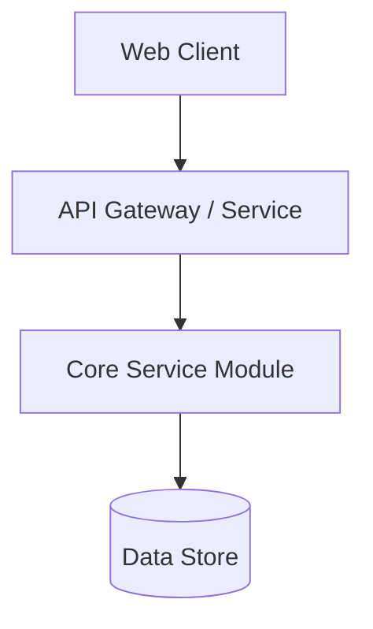

## Context

<!-- Background, current state, architectural context, and system constraints -->

## Goals / Non-Goals

**Goals:**

<!-- What this technical design achieves -->

**Non-Goals:**

<!-- Explicitly excluded scope or future concerns -->

## Architecture & C4 Diagrams

<!-- Visual system boundaries and component relationships using C4 models (Mermaid or ASCII).
     Context: System interactions with users and external services.
     Container: Applications, services, databases, message brokers.
     Component: Internal modules, managers, controllers, repositories. -->

## Decisions

<!-- Key technical decisions, trade-offs, and alternatives considered (why option A over option B?) -->

## Risks / Trade-offs

<!-- Known risks and mitigation strategies:
     - [Risk 1] -> Mitigation strategy
     - [Risk 2] -> Mitigation strategy -->

## Migration Plan

<!-- Deployment steps, backward compatibility, database migration, and rollback procedures -->

## Open Questions

<!-- Outstanding decisions to resolve, including any in-force ADRs requiring supersession -->
